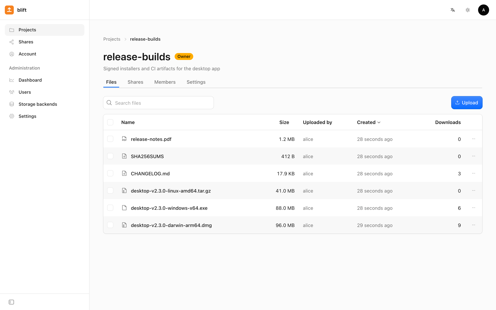
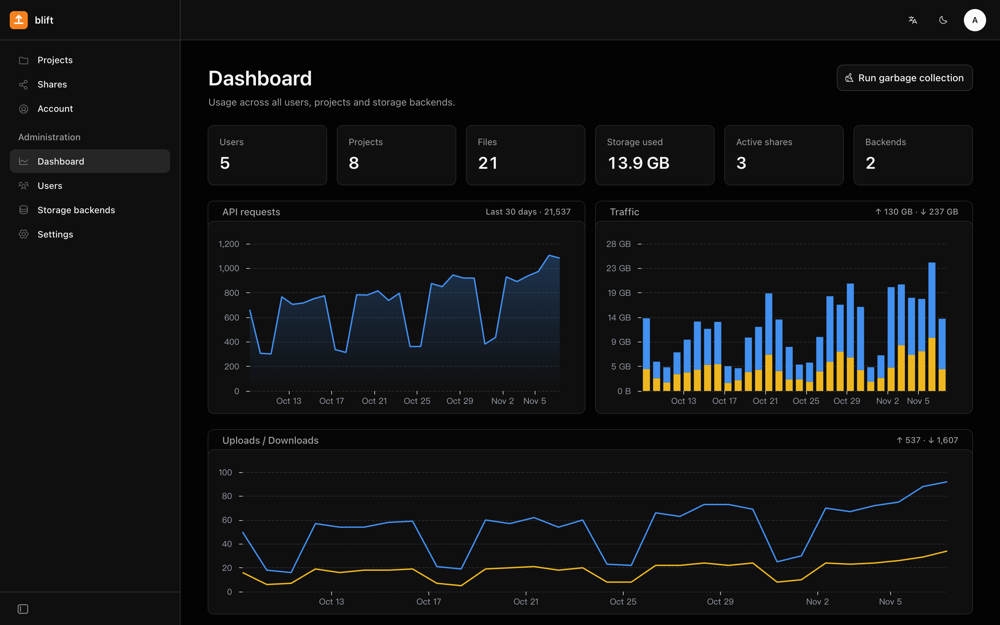
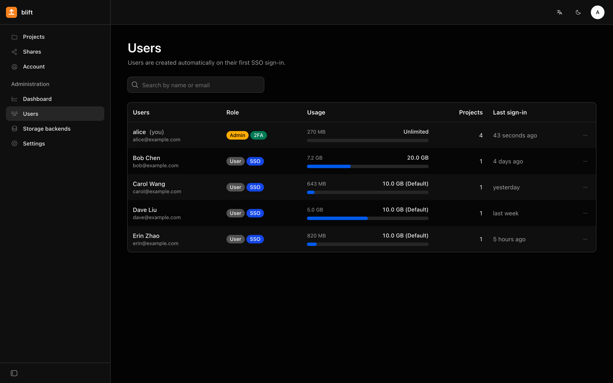
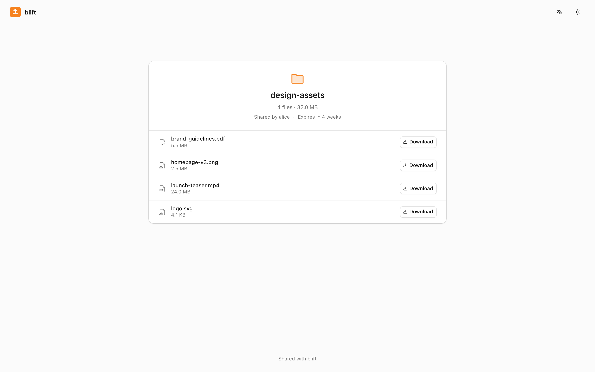
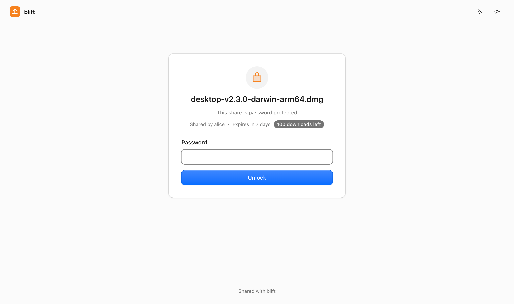
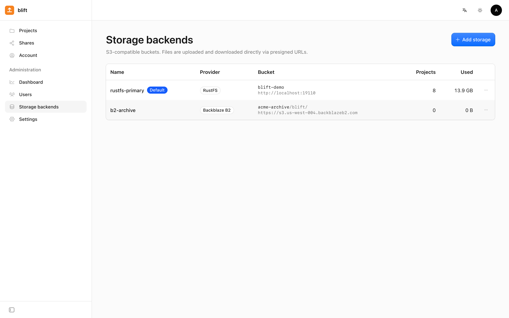
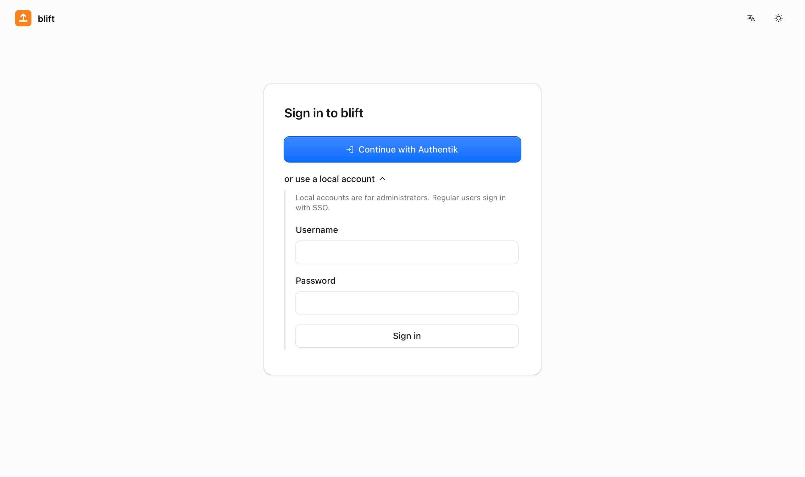
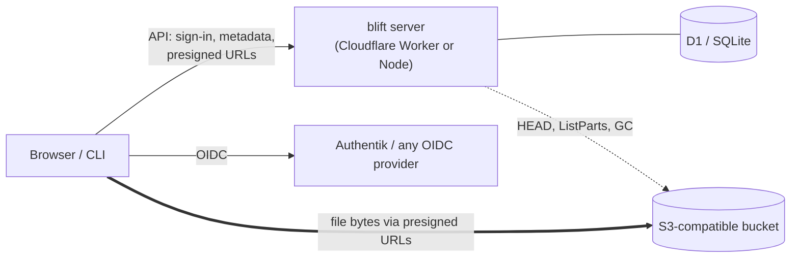

# blift

[](https://github.com/davidliyutong/blift/actions/workflows/ci.yml)
[](https://github.com/davidliyutong/blift/releases)
[](LICENSE)

English | [简体中文](README.zh-cn.md)

**blift** is a lightweight file-sharing and transfer service for teams, built on any
S3-compatible object storage (Cloudflare R2, Backblaze B2, AWS S3, RustFS, MinIO…). It runs
natively on **Cloudflare Workers** (D1 + Workers Assets + Cron) or self-hosted with **Docker**
(Node + SQLite), and comes with a web UI in Cloudflare's own design language and a single-binary
**Go CLI** that signs in through the browser.

File bytes never pass through the server: browsers and the CLI upload and download straight
from the bucket with presigned URLs, while blift handles accounts, permissions, sharing, quotas
and bookkeeping.



## Features

- **Flat by design.** Projects contain files, nothing more: no folder trees to manage.
- **Direct transfers.** Presigned single `PUT` up to 64 MiB, parallel multipart uploads above
  that (each part retried on its own), parallel ranged downloads in the CLI.
- **Any S3-compatible storage.** Several backends side by side, chosen per project (an optional
  location label such as "Singapore" helps users pick); `Apply CORS` configures the bucket from
  the admin UI.
- **Sharing.** Public links for a single file or a whole project, with optional password,
  expiry and download limit; recipients need no account, and `wget` / `curl` download straight
  from the link.
- **Inbox.** Upload links (choose "Inbox" when creating a share link) let anyone add files to a
  project, with a password, expiry and limits on the number of files and their total size; senders
  need no account and see nothing in the project, and a name that is taken gets a number instead
  of replacing.
- **Single sign-on.** OIDC with PKCE, tuned for Authentik; HS256, RS256 and ES256 ID tokens;
  users are created on first sign-in and an IdP group can grant the admin role.
- **Security.** TOTP two-factor authentication, one-off bootstrap secret for the first admin,
  session tokens stored hashed, storage and IdP credentials encrypted at rest.
- **Administration.** Dashboard with usage, request and traffic charts; user management with
  per-user quotas; storage backends and SSO configured online.
- **CLI.** Browser-based login (device flow) or API keys for unattended installs, project and member management, parallel
  uploads/downloads, share links, password-protected share downloads and inbox uploads without an
  account.
  Static binaries for Linux and macOS on amd64 and arm64.
- **Garbage collection.** Stale uploads, deleted files and projects, expired sessions and
  shares are cleaned up on a schedule within Cloudflare's subrequest limits.
- **English and Chinese** in the web UI and the CLI, light and dark themes.

## Screenshots

| | |
| --- | --- |
|  |  |
| Admin dashboard: requests, traffic, uploads and downloads | Users with quotas, SSO and 2FA badges |
|  |  |
| A shared project, no account needed | Password, expiry and download limit |
|  |  |
| Several S3-compatible backends | SSO first, local accounts for admins |

## How it works



One TypeScript codebase ([Hono](https://hono.dev)) serves both runtimes; the database layer is
a small subset of the D1 API, implemented on Node with `node:sqlite`. The HTTP contract shared by
the server, the web UI and the CLI lives in [docs/API.md](docs/API.md).

## Quick start

### Docker

```sh
docker run -d --name blift -p 8080:8080 -v blift-data:/data \
  -e PUBLIC_URL=https://files.example.com \
  ghcr.io/davidliyutong/blift:latest
docker logs blift        # prints the one-off bootstrap secret on first start
```

Open `/setup`, create the admin with the bootstrap secret, then add a storage backend under
**Administration → Storage backends**. All state lives in `/data` (SQLite database and the
generated `app-secret`): back it up, because losing `APP_SECRET` makes the stored S3 and OIDC
credentials unreadable. [deploy/docker-compose.yml](deploy/docker-compose.yml) has the same setup
plus an optional RustFS service (`--profile s3`).

Images are published for `linux/amd64` and `linux/arm64` with tags `latest`, `X.Y` and `X.Y.Z`.

### Cloudflare Workers

Requires a Cloudflare account, Node.js ≥ 22.13, pnpm and Go (for the CLI).

```sh
git clone https://github.com/davidliyutong/blift && cd blift
make install
pnpm --filter server exec wrangler login
make cf-init        # creates the D1 database and server/wrangler.local.toml (git-ignored)
make cf-secrets     # stores APP_SECRET and BOOTSTRAP_SECRET, prints the latter
make deploy         # builds the web UI and deploys API + static assets + the GC cron
```

Migrations run automatically on the first request. The committed `server/wrangler.toml` is a
template; your deployment's values (D1 id, custom domain, `PUBLIC_URL`) go in
`server/wrangler.local.toml`, which the Makefile uses whenever it exists. `make cf-init` copies
the template once: when an upgrade changes it (CHANGELOG.md says so, e.g. a new `run_worker_first`
path), make the same change in your copy. For a custom domain add
`routes = [{ pattern = "files.example.com", custom_domain = true }]` together with
`workers_dev = true` (wrangler otherwise turns the `*.workers.dev` URL off), and set `PUBLIC_URL`
under `[vars]` when the Worker has more than one hostname.

To deploy automatically from GitHub, connect the repository under the Worker's Settings → Builds
([Workers Builds](https://developers.cloudflare.com/workers/ci-cd/builds/)) with build command
`pnpm install --frozen-lockfile && make cf-config`, deploy command `make deploy`, and the build
variables `CF_D1_ID` (the D1 database id) plus, optionally, `CF_DOMAIN` (custom domain) and
`PUBLIC_URL`. `make cf-config` writes `server/wrangler.local.toml` from the template on every
build, so template changes are picked up without manual edits.

### Local development

```sh
make install
make dev            # API on :8787 (Node + SQLite in ./data) and the web UI on :5173
docker run -d -p 9000:9000 -e RUSTFS_ACCESS_KEY=blift -e RUSTFS_SECRET_KEY=blift-secret rustfs/rustfs
```

The bootstrap secret is printed on first start (and saved in `data/bootstrap-secret`). Add the
RustFS bucket with endpoint `http://localhost:9000`, region `us-east-1` and path-style on, then
click **Apply CORS**.

## Configuration

| Variable | Description |
| --- | --- |
| `PUBLIC_URL` | Canonical origin for share links, the OIDC redirect URI and CLI login links. Defaults to the request's host (`X-Forwarded-*` aware). |
| `BOOTSTRAP_SECRET` | One-off secret to create the first admin. Docker generates it into `/data/bootstrap-secret` when unset. Stops working once an active admin exists. |
| `APP_SECRET` | Signs cookies and tokens and encrypts stored credentials. Docker generates it into `/data/app-secret` when unset. |
| `PORT`, `DATA_DIR`, `WEB_DIR` | Node only. Defaults: `8080`, `/data`, `/app/web`. |
| `GC_BUDGET` | Maximum S3 requests per garbage-collection run (Node 1000, Workers 40). |
| `GC_ROWS` | Maximum database rows garbage collection writes per run, in statements of at most 100 rows (Node 20000, Workers 5000). Deleting a project or many files only flags them; GC removes them over as many runs as needed. |

Everything else (site name, default quota, storage backends, SSO) is configured in the web UI.

## Storage backends

Browsers talk to the bucket directly, so the bucket must allow CORS from blift's origin
(`GET`, `PUT`, `HEAD`, any header). **Apply CORS** in the admin UI sets this with
`PutBucketCors` where the provider and key allow it. The endpoint must be reachable under the
same URL by the server and by users' browsers, since presigned URLs are bound to the host.

| Provider | Endpoint | S3 region | Path-style | Notes |
| --- | --- | --- | --- | --- |
| Cloudflare R2 | `https://<ACCOUNT_ID>.r2.cloudflarestorage.com` | `auto` | on | R2 API token with Object Read & Write |
| Backblaze B2 | `https://s3.<region>.backblazeb2.com` | e.g. `us-west-004` | on | needs the lifecycle rule below |
| AWS S3 | `https://s3.<region>.amazonaws.com` | e.g. `us-east-1` | off | |
| RustFS / MinIO | `http(s)://<host>:9000` | `us-east-1` | on | |

The S3 region is the signing region the provider expects. **Location** is separate and optional:
a label such as "Singapore" or "US West" that users see next to the backend's name when they
create a project.

**Backblaze B2.** B2 keeps every version of a file, and an S3 delete without a version id only
hides it. Set the bucket's lifecycle to **Keep only the last version of the file**, otherwise
deleted files keep using (and billing) space. Use a private bucket without Object Lock and an
application key restricted to it with read and write access (the master key does not work with
the S3 API). The B2 console's CORS presets do not allow uploads: either click **Apply CORS** once
with a key that is not restricted to one bucket, or set the rules with the
[b2 CLI](https://www.backblaze.com/docs/cloud-storage-command-line-tools):

```sh
b2 bucket update <bucket> allPrivate --cors-rules '[{"corsRuleName":"blift","allowedOrigins":["https://files.example.com"],
  "allowedOperations":["s3_get","s3_head","s3_put"],"allowedHeaders":["*"],"exposeHeaders":["ETag"],"maxAgeSeconds":3600}]'
```

## Single sign-on (Authentik)

1. In Authentik, create an **OAuth2/OpenID Provider** (client type *Confidential*) with the
   redirect URI shown in blift's settings: `https://<your-domain>/api/auth/oidc/callback`.
   With a signing key the ID token is RS256; without one it is HS256 signed with the client
   secret. Both work.
2. Create an **Application** that uses the provider and note its slug.
3. In blift, **Administration → Settings → OIDC**: issuer
   `https://<authentik>/application/o/<slug>/`, client id and secret, scopes
   `openid profile email`. **Test** checks the discovery document.
4. Optionally set an **admin group** (e.g. `blift-admins`): members become admins when they sign in.

Users are created on their first sign-in; an existing local account with the same email is
linked instead. Users who enable blift's TOTP enter their code after the SSO round trip.

## CLI

Every blift server hosts an installer for the CLI release that matches its version
(Linux and macOS, amd64 and arm64; `| bash` works as well):

```sh
curl -fsSL https://files.example.com/install.sh | sh
```

The archive comes through the blift server itself, which relays GitHub Releases (on Workers
from Cloudflare's edge cache), so machines that cannot reach GitHub can still install it. If the
relay fails, e.g. a server without internet access, the script downloads from GitHub directly.
It checks the archive against `SHA256SUMS` and installs to your own `~/.local/bin` (no sudo),
printing how to add it to `PATH` if needed. `BLIFT_INSTALL_DIR`, `BLIFT_VERSION` and
`BLIFT_DOWNLOAD_URL` (download only from this mirror of the release files) change those defaults.
Account settings in the web UI show the command for your server.

To set up machines without a browser (servers, CI, provisioning scripts), create an **API key** under
Account → API keys (single use or a number of uses, with an expiry) and pass it to the installer,
which then signs in right away:

```sh
curl -fsSL https://files.example.com/install.sh | BLIFT_API_KEY=bliftk_… sh
```

`blift login --api-key bliftk_…` (or `BLIFT_API_KEY=… blift login`) does the same for an installed
CLI. Every use creates a CLI session listed under Account → Sessions, valid for the key's sign-in
lifetime: 7 to 365 days (90 by default) or until revoked; deleting the key can sign those out as well.

Or download the archive for your platform from the
[latest release](https://github.com/davidliyutong/blift/releases/latest) yourself:

```sh
VER=0.2.0 OS=$(uname -s | tr A-Z a-z) ARCH=$(uname -m | sed 's/x86_64/amd64/;s/aarch64/arm64/')
curl -fsSL "https://github.com/davidliyutong/blift/releases/download/v$VER/blift_${VER}_${OS}_${ARCH}.tar.gz" | tar -xz
mkdir -p ~/.local/bin && install "blift_${VER}_${OS}_${ARCH}/blift" ~/.local/bin/
```

Or build it: `make cli` (this platform) or `make cli-all` (Linux and macOS, amd64 and arm64).

```console
$ blift login --server https://files.example.com     # approve the sign-in in your browser
$ blift project ls
NAME            OWNER  ROLE   FILES  SIZE       UPDATED           ID
datasets        alice  owner  2      12.0 MiB   2026-11-07 20:39  2rrrsvmr54gnc3ua
design-assets   alice  owner  4      32.0 MiB   2026-11-07 20:39  23qs5oxdm6teokgb
release-builds  alice  owner  6      226.3 MiB  2026-11-07 20:39  nkqboruqznospkir
$ blift upload datasets ./build.tar.gz -j 8
✓ Uploaded build.tar.gz (2.9 MiB) to datasets
$ blift share create release-builds CHANGELOG.md --password launch --expires 7d
https://files.example.com/s/83aAZff7bSgz
✓ Share created (expires: 2026-11-14 20:41)
$ blift share get https://files.example.com/s/83aAZff7bSgz --password launch    # no account needed
```

`blift update` replaces the binary with the latest release (through the server's relay, like the
installer; `--check` only looks). Shell completion covers projects, file names (looked up by prefix on the server), shares and
users: `blift completion zsh|bash|fish` prints the script. See [cli/README.md](cli/README.md) for
all commands. The language follows `LANG`, or
`--lang zh|en` / `BLIFT_LANG`.

## Design notes and Cloudflare limits

- File bytes never go through the Worker (100 MB request bodies, scarce CPU). Multipart uploads
  use a fixed part size of at least 16 MiB (R2 requires equal parts) and up to 10,000 parts.
- Part URLs are signed locally in batches of up to 100, costing no subrequests. On completion the
  server collects ETags with `ListParts` and checks the real size with `HEAD` before counting it
  against the quota.
- Each GC run stays within a subrequest budget (50 per invocation on the free plan), deletes with
  `DeleteObjects` (1,000 keys per call) and keeps outbound concurrency at 6 or less.
- D1: at most 100 bound parameters per statement (`IN (...)` lists are chunked), multi-statement
  writes in `batch`, one stats upsert per request in `waitUntil`, session "last used" written at
  most every 5 minutes.
- Passwords use PBKDF2-SHA256 with 100,000 iterations, the Workers maximum. On the free plan's
  10 ms CPU limit a password sign-in can occasionally time out; use SSO or the paid plan.
- Deletes are asynchronous: quota is released immediately and GC removes the objects; usage
  counters are reconciled against the real data once a day.
- Download traffic is counted from the file size when a download URL is issued, since the bytes
  never reach the server.

## Development

```text
server/   API (TypeScript + Hono), the same code on Workers and Node
web/      web UI (React 19, Vite, @cloudflare/kumo, English and Chinese)
cli/      Go CLI
docs/     API.md, the contract shared by server, web UI and CLI
deploy/   Dockerfile, docker-compose.yml
scripts/  smoke.sh, the end-to-end test (RustFS container + real server + CLI)
```

`make help` lists the targets. `make test` runs the typecheck and the unit tests,
`make smoke` the end-to-end suite (needs Docker), `make build` everything. Changes to the API
start in [docs/API.md](docs/API.md); [AGENTS.md](AGENTS.md) describes the architecture and the
conventions for contributors (human or not), and [CONTRIBUTING.md](CONTRIBUTING.md) the workflow
and the format of commit messages, pull requests and issues (in English). Releases are described
in [RELEASING.md](RELEASING.md).

## License

[MIT](LICENSE)
