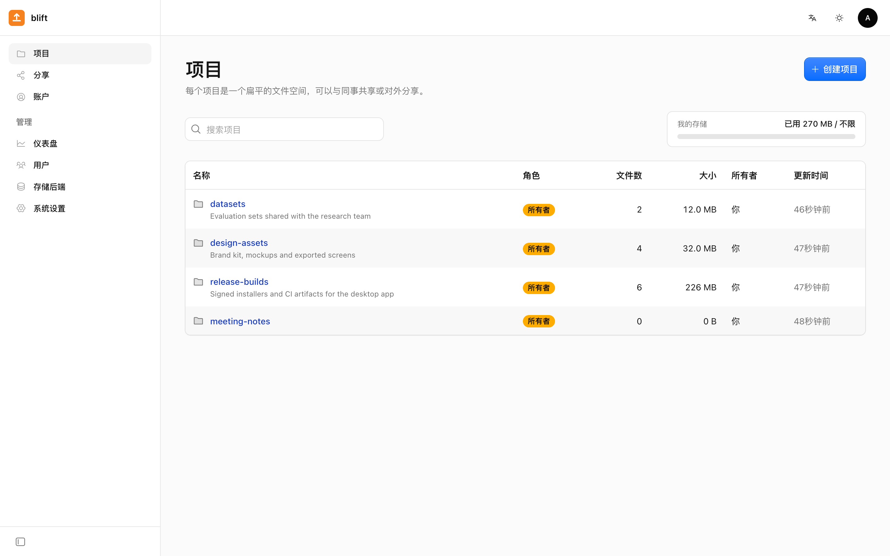
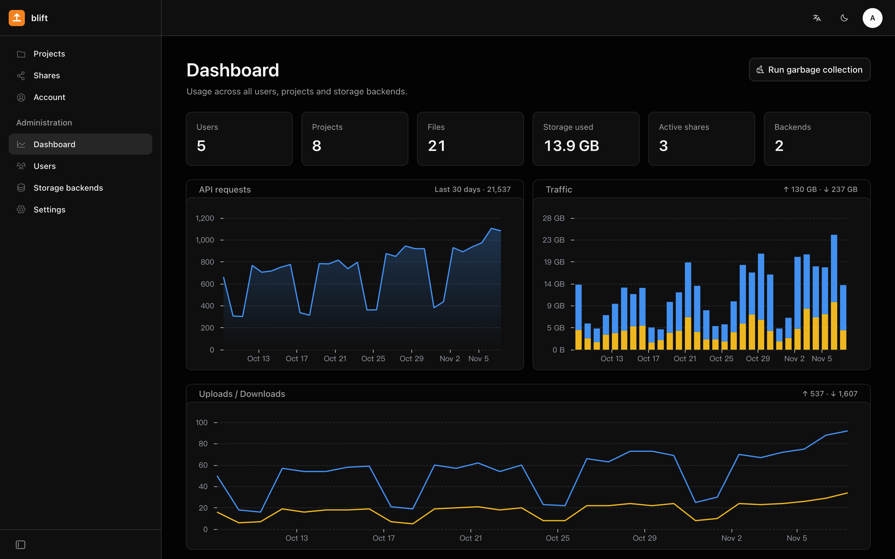
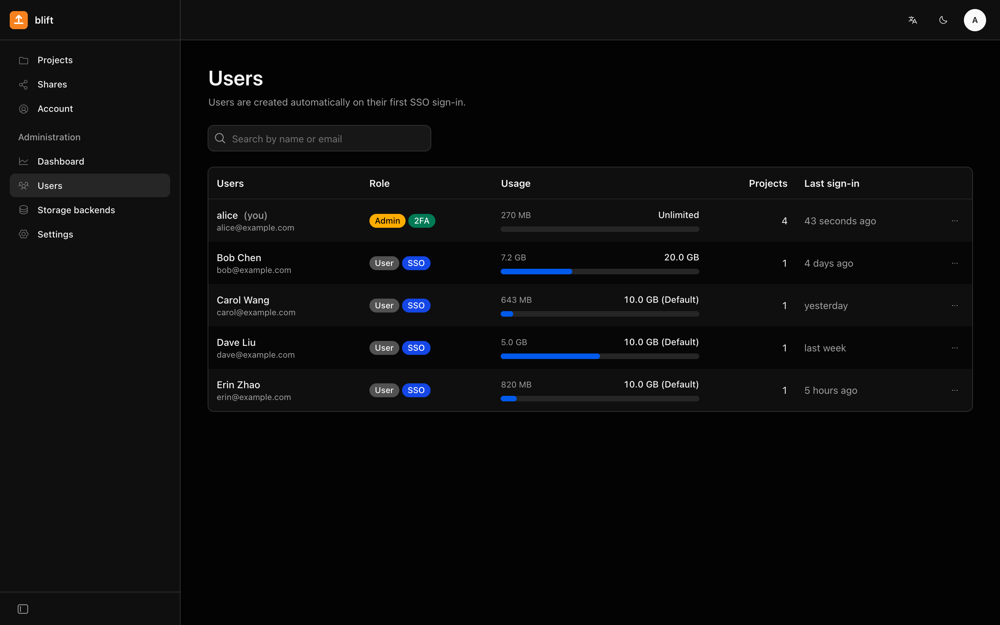
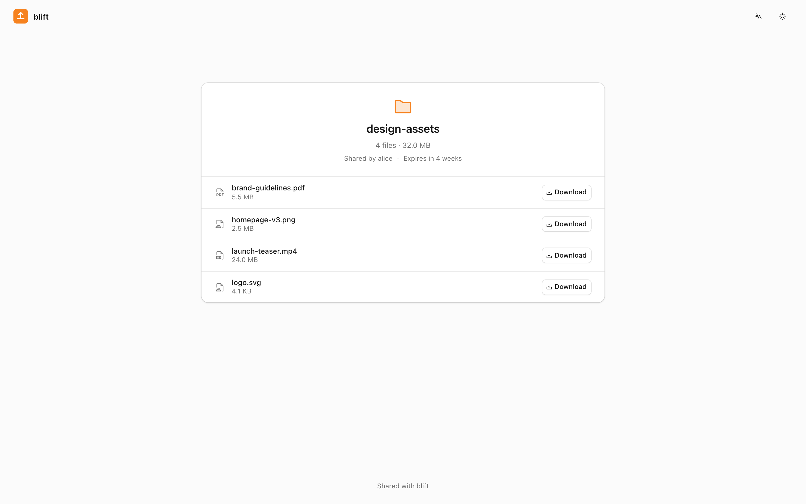
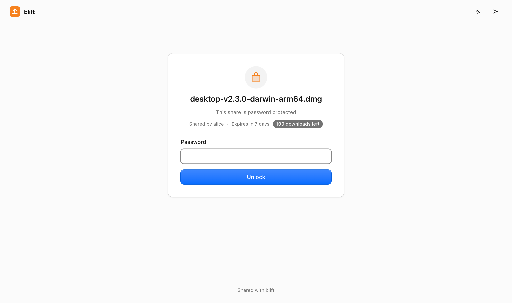
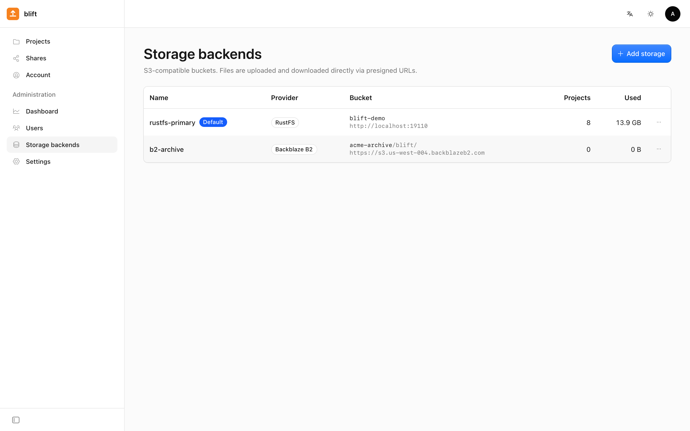
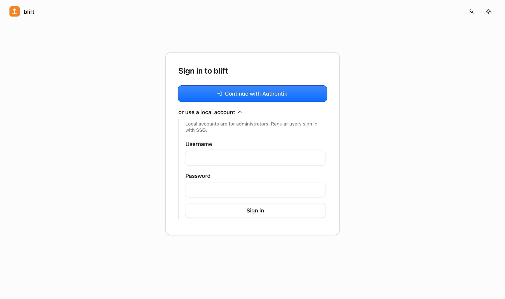
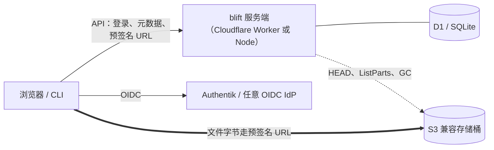

# blift

[](https://github.com/davidliyutong/blift/actions/workflows/ci.yml)
[](https://github.com/davidliyutong/blift/releases)
[](LICENSE)

[English](README.md) | 简体中文

**blift** 是面向团队的轻量文件共享 / 传输系统，以任意 S3 兼容对象存储（Cloudflare R2、Backblaze B2、
AWS S3、RustFS、MinIO……）为后端。它原生运行在 **Cloudflare Workers**（D1 + Workers Assets + Cron），
也可以用 **Docker** 自托管（Node + SQLite）；自带采用 Cloudflare 控制台设计语言的 Web 界面，以及在浏览器里授权登录的
单文件 **Go CLI**。

文件字节从不经过服务端：浏览器和 CLI 通过预签名 URL 直接与存储桶上传下载，blift 只负责账号、权限、
分享、配额与记账。



## 特性

- **极简结构**：只有「项目 → 文件」两级，没有文件夹树。
- **直传**：≤ 64 MiB 的文件单次预签名 `PUT`，更大的自动分片并行上传（单片失败单独重试）；CLI 分段并行下载。
- **任意 S3 兼容存储**：可同时配置多个后端，按项目选择；管理页「应用 CORS」一键配置存储桶。
- **分享**：单个文件或整个项目的公开链接，可设访问密码、有效期、下载次数上限；接收方无需账号。
- **单点登录**：OIDC + PKCE，优先适配 Authentik；ID Token 支持 HS256 / RS256 / ES256；首次登录自动注册，
  可按 IdP 用户组授予管理员。
- **安全**：TOTP 两步验证；一次性 bootstrap secret 创建首个管理员；会话令牌只存哈希；存储与 IdP 凭据加密保存。
- **管理**：仪表盘查看用量、请求数、流量；用户管理与配额调整；在线配置存储后端与 SSO。
- **CLI**：浏览器设备码授权登录；项目与成员管理、并行上传下载、分享，免登录下载加密分享；
  Linux / macOS × amd64 / arm64 静态单文件。
- **垃圾回收**：未完成的上传、已删除的文件与项目、过期的会话与分享定时清理，并遵守 Cloudflare 子请求限制。
- Web 与 CLI 均支持**中文 / English**，浅色 / 深色主题。

## 截图

| | |
| --- | --- |
|  |  |
| 管理仪表盘：请求数、流量、上传下载 | 用户：配额、SSO 与两步验证标记 |
|  |  |
| 分享整个项目，无需账号 | 访问密码、有效期与下载次数上限 |
|  |  |
| 多个 S3 兼容后端 | SSO 优先，本地账户供管理员使用 |

## 工作原理



同一份 TypeScript 代码（[Hono](https://hono.dev)）运行在两种运行时上；数据库层是 D1 API 的一个小子集，
在 Node 上用 `node:sqlite` 实现。服务端、Web 与 CLI 共同遵守的接口契约见 [docs/API.md](docs/API.md)。

## 快速开始

### Docker

```sh
docker run -d --name blift -p 8080:8080 -v blift-data:/data \
  -e PUBLIC_URL=https://files.example.com \
  ghcr.io/davidliyutong/blift:latest
docker logs blift        # 首次启动会打印一次性的 bootstrap secret
```

打开 `/setup`，用 bootstrap secret 创建管理员，再到「管理 → 存储后端」添加存储。所有状态都在 `/data`
（SQLite 数据库 + 自动生成的 `app-secret`），请备份该卷：丢失 `APP_SECRET` 会导致已保存的 S3 / OIDC 凭据无法解密。
[deploy/docker-compose.yml](deploy/docker-compose.yml) 提供同样的配置，并含可选的 RustFS（`--profile s3`）。

镜像提供 `linux/amd64` 与 `linux/arm64`，标签为 `latest`、`X.Y`、`X.Y.Z`。

### Cloudflare Workers

需要 Cloudflare 账号、Node.js ≥ 22.13、pnpm，以及 Go（构建 CLI）。

```sh
git clone https://github.com/davidliyutong/blift && cd blift
make install
pnpm --filter server exec wrangler login
make cf-init        # 创建 D1 数据库，生成 server/wrangler.local.toml（git 忽略）
make cf-secrets     # 写入 APP_SECRET 与 BOOTSTRAP_SECRET，并打印后者
make deploy         # 构建前端并部署 API + 静态资源 + GC 定时任务
```

数据库迁移在第一次请求时自动执行。仓库里的 `server/wrangler.toml` 只是模板；你自己的部署配置（D1 ID、
自定义域名、`PUBLIC_URL`）放在 `server/wrangler.local.toml`，Makefile 检测到它就会使用。自定义域名：加上
`routes = [{ pattern = "files.example.com", custom_domain = true }]`，并同时写 `workers_dev = true`
（否则 wrangler 会关闭 `*.workers.dev` 地址）；Worker 有多个域名时，在 `[vars]` 中设置 `PUBLIC_URL` 作为规范地址。

### 本地开发

```sh
make install
make dev            # API :8787（Node + SQLite，数据在 ./data）+ Web :5173
docker run -d -p 9000:9000 -e RUSTFS_ACCESS_KEY=blift -e RUSTFS_SECRET_KEY=blift-secret rustfs/rustfs
```

首次启动会打印 bootstrap secret（也保存在 `data/bootstrap-secret`）。添加存储时 endpoint 填
`http://localhost:9000`、region `us-east-1`、开启 path-style，再点「应用 CORS」。

## 配置

| 环境变量 | 说明 |
| --- | --- |
| `PUBLIC_URL` | 规范访问地址，用于分享链接、OIDC 回调与 CLI 登录链接。默认取请求的 Host（识别 `X-Forwarded-*`） |
| `BOOTSTRAP_SECRET` | 创建首个管理员的一次性密钥；Docker 下未设置则自动生成到 `/data/bootstrap-secret`。存在活跃管理员后失效 |
| `APP_SECRET` | 签名 Cookie / 令牌并加密已保存的凭据；Docker 下未设置则自动生成到 `/data/app-secret` |
| `PORT`、`DATA_DIR`、`WEB_DIR` | 仅 Node。默认 `8080`、`/data`、`/app/web` |
| `GC_BUDGET` | 每轮垃圾回收最多发起的 S3 请求数（Node 1000，Workers 40） |

其余配置（站点名称、默认配额、存储后端、SSO）都在 Web 管理页里完成。

## 存储后端

浏览器直接访问存储桶，因此存储桶必须允许来自 blift 域名的 CORS（`GET`、`PUT`、`HEAD`，任意 Header）。
管理页的「应用 CORS」会在服务商和密钥允许时调用 `PutBucketCors` 自动配置。存储的 endpoint 必须能被服务端
和用户浏览器以**同一个地址**访问（预签名 URL 绑定了 Host）。

| 服务 | Endpoint | Region | Path-style | 备注 |
| --- | --- | --- | --- | --- |
| Cloudflare R2 | `https://<ACCOUNT_ID>.r2.cloudflarestorage.com` | `auto` | 开 | R2 API Token（Object Read & Write） |
| Backblaze B2 | `https://s3.<region>.backblazeb2.com` | 如 `us-west-004` | 开 | 必须设置生命周期，见下文 |
| AWS S3 | `https://s3.<region>.amazonaws.com` | 如 `us-east-1` | 关 | |
| RustFS / MinIO | `http(s)://<host>:9000` | `us-east-1` | 开 | |

**Backblaze B2**：B2 会保留文件的所有版本，S3 接口不带版本号的删除只会把文件隐藏。请把存储桶生命周期设为
**Keep only the last version of the file**，否则删除的文件会一直占用空间、产生费用。使用不开 Object Lock 的私有桶，
密钥限定到该桶、读写权限即可（主密钥不能用于 S3 接口）。B2 控制台的 CORS 预设不允许上传：可以用一个不限定桶的密钥
点一次「应用 CORS」，或者用 [b2 CLI](https://www.backblaze.com/docs/cloud-storage-command-line-tools) 设置：

```sh
b2 bucket update <bucket> allPrivate --cors-rules '[{"corsRuleName":"blift","allowedOrigins":["https://files.example.com"],
  "allowedOperations":["s3_get","s3_head","s3_put"],"allowedHeaders":["*"],"exposeHeaders":["ETag"],"maxAgeSeconds":3600}]'
```

## 单点登录（Authentik）

1. Authentik → 新建 **OAuth2/OpenID Provider**（Client type 选 *Confidential*），Redirect URI 填 blift 设置页显示的
   `https://<你的域名>/api/auth/oidc/callback`。选了 Signing Key 则 ID Token 为 RS256，不选则为以 client secret
   签名的 HS256，两者都支持。
2. 新建 **Application** 绑定该 Provider，记下 slug。
3. blift →「管理 → 系统设置 → OIDC」：Issuer 填 `https://<authentik>/application/o/<slug>/`，填入 Client ID / Secret，
   Scopes 保持 `openid profile email`，可点「测试」检查 discovery。
4. 可选「管理员组」（如 `blift-admins`）：该组成员登录时自动成为管理员。

新用户首次登录即自动注册；若邮箱与已有本地账号一致，则关联到该账号。开启了 blift TOTP 的用户在 SSO 之后
还需输入验证码。

## CLI

每个 blift 服务端都自带 CLI 安装脚本，安装与服务端版本一致的 CLI（Linux / macOS × amd64 / arm64；
`| bash` 也可以）：

```sh
curl -fsSL https://files.example.com/install.sh | sh
```

压缩包经由 blift 服务端中转 GitHub Release 下载（Workers 上命中 Cloudflare 边缘缓存），访问不了 GitHub
的机器也能安装；中转失败时（例如服务端本身不能上外网）改为直连 GitHub。下载后按 `SHA256SUMS` 校验，
安装到当前用户的 `~/.local/bin`（无需 sudo），如果它不在 `PATH` 中会给出加入的命令。可用 `BLIFT_INSTALL_DIR`、
`BLIFT_VERSION`、`BLIFT_DOWNLOAD_URL`（只从这个 Release 文件镜像下载）修改默认值。Web 界面「账户设置」里会显示适用于当前服务器的命令。

也可以从[最新 Release](https://github.com/davidliyutong/blift/releases/latest) 手动下载对应平台的压缩包：

```sh
VER=0.1.1 OS=$(uname -s | tr A-Z a-z) ARCH=$(uname -m | sed 's/x86_64/amd64/;s/aarch64/arm64/')
curl -fsSL "https://github.com/davidliyutong/blift/releases/download/v$VER/blift_${VER}_${OS}_${ARCH}.tar.gz" | tar -xz
mkdir -p ~/.local/bin && install "blift_${VER}_${OS}_${ARCH}/blift" ~/.local/bin/
```

或自行构建：`make cli`（本机平台）、`make cli-all`（Linux / macOS × amd64 / arm64）。

```console
$ blift login --server https://files.example.com     # 在浏览器中确认授权
$ blift project ls
$ blift upload datasets ./build.tar.gz -j 8
$ blift download datasets build.tar.gz -o ./out/
$ blift share create release-builds CHANGELOG.md --password launch --expires 7d
$ blift share get https://files.example.com/s/83aAZff7bSgz --password launch    # 无需登录
```

全部命令见 [cli/README.md](cli/README.md)。界面语言跟随 `LANG`，或用 `--lang zh|en` / `BLIFT_LANG`。

## 设计取舍与 Cloudflare 限制

- 文件字节从不经过 Worker（请求体上限 100 MB、CPU 时间宝贵）。分片上传使用 ≥ 16 MiB 的固定分片大小
  （满足 R2 等长分片要求），最多 10 000 片。
- 分片 URL 每批 ≤ 100 个，在本地签名，不产生子请求；完成上传时服务端用 `ListParts` 收集 ETag，并 `HEAD`
  校验实际大小后才计入配额。
- 每轮 GC 的子请求数受预算控制（免费版每次调用 50 个），删除使用 `DeleteObjects`（每次 1000 个 key），出站并发 ≤ 6。
- D1：单条语句绑定参数 ≤ 100（`IN (...)` 自动分块），多语句写入用 `batch`，统计每请求一次 upsert 且放在
  `waitUntil` 中，会话最近使用时间最多 5 分钟写一次。
- 密码使用 PBKDF2-SHA256 10 万次迭代（Workers 上限）；免费版 10 ms CPU 限制下密码登录偶尔可能超时，建议用 SSO 或付费版。
- 删除是异步的：配额立即释放，对象由 GC 清理；用量计数每天按实际数据校准一次。
- 下载流量按签发下载链接时的文件大小统计（字节不经过服务端，无法精确计量）。

## 开发

```text
server/   API（TypeScript + Hono），同一份代码跑在 Workers 和 Node 上
web/      Web 前端（React 19、Vite、@cloudflare/kumo，中英双语）
cli/      Go 命令行客户端
docs/     API.md —— 服务端 / Web / CLI 共同遵守的接口契约
deploy/   Dockerfile、docker-compose.yml
scripts/  smoke.sh —— 端到端测试（RustFS 容器 + 真实服务端 + CLI）
```

`make help` 列出所有目标：`make test` 类型检查与单元测试，`make smoke` 端到端测试（需要 Docker），
`make build` 构建全部。修改 API 先改 [docs/API.md](docs/API.md)；[AGENTS.md](AGENTS.md) 描述架构与协作约定；
发版流程见 [RELEASING.md](RELEASING.md)。

## 许可

[MIT](LICENSE)
